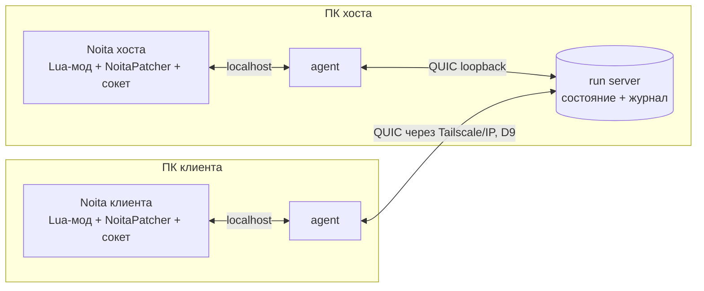
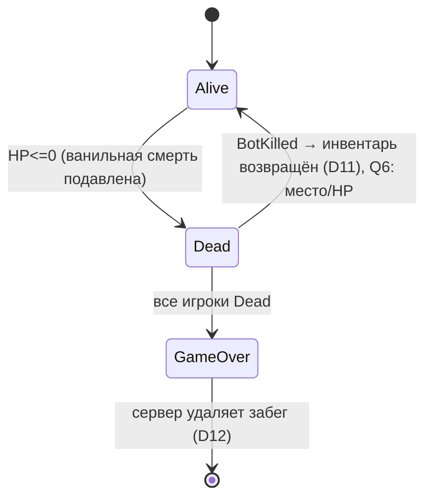

# Архитектура (предложение, v0)

Статус: проектное предложение по итогам анализа 2026-11-18. Код ещё не написан. Решения, на которые
опирается документ: D1–D15 (`docs/DECISIONS.md`). Места, которые зависят от неотвеченных вопросов,
помечены `Qn`. Факты о движке и EW взяты из `docs/research/*`.

## 1. Принципы

1. **Сервер забега единственный источник правды (D3).** Это отдельный процесс на машине хоста.
   Noita хоста подключается к нему так же, как Noita клиентов. Вылет игры хоста не уничтожает уже
   подтверждённое сервером состояние; неприсланная симуляция ограничена окном контрольных точек.
2. **Сервер не симулирует игру.** Симулирует Noita игроков. Сервер назначает авторитетов,
   арбитрирует конфликты (кто первый подобрал), хранит состояние и журнал событий.
3. **Одна сущность и одна область имеют ровно одного авторитета** в каждый момент. Плановая
   передача переносит снимок до смены владельца. При аварии используется последний
   подтверждённый снимок; сервер увеличивает эпоху владения и отвергает пакеты старого владельца.
4. **Дискретные общие изменения — события с ID** в журнале. Непрерывная симуляция местности и
   физики передаётся версионированными снимками/дельтами, а не событием на каждый пиксель.
5. **Локальный сейв Noita — кэш.** При загрузке чанка, игрока или сущности версия сервера
   перезаписывает локальную.
6. **Детерминизм генерации мира используется для экономии, а не как гарантия корректности.**
   Сервер хранит отличия от сгенерированного мира. Всё, что генерация спавнит (мобы, предметы),
   классифицируется (§6) и либо регистрируется на сервере один раз, либо создаётся персонально.

## 2. Компоненты



| Компонент | Язык / форма | Ответственность |
|---|---|---|
| **mod** (`mod/`) | Lua (LuaJIT 2.0.4 внутри Noita), unsafe-мод (`request_no_api_restrictions`) | Хуки ванильных скриптов, захват и применение состояния мира, сущностей и игроков, UI (лобби, статус, спектатор), ИИ бота |
| **NoitaPatcher** (сторонний, D8) | Win32 DLL + LuaJIT FFI | Кандидат для сериализации сущностей, `SetPlayerEntity`, отключения паузы и контроля RNG. Чтение/запись мира требует проверки происхождения конкретного модуля (см. ниже) |
| **сокет в игре** | pollnet (сторонний, D8) или собственная маленькая Win32 DLL | Неблокирующий TCP/WebSocket до `agent` на localhost. Под Proton localhost Wine совпадает с localhost Linux (так работает EW) |
| **agent** (`agent/`) | Rust, нативный Linux-бинарь | Мост игра↔сервер: переподключение без участия игры, буферизация, сжатие, приоритизация трафика, локальные логи. Lua не знает про сеть |
| **run server** (`server/`) | Rust (тот же бинарь в режиме `serve` или отдельный крейт) | Авторитетное состояние забега, назначение авторитетов, арбитраж, журнал событий, снапшоты и бэкапы, проверка совместимости |
| **protocol** (`protocol/`) | Rust-крейт + генерируемая или ручная схема для Lua | Версионированный бинарный протокол. Один источник для agent, server и тестов |

Почему не встраивать сеть в игру целиком: при вылете Noita теряются очередь и
состояние; Lua плохо подходит для надёжной доставки и сжатия; нативный процесс на Linux проще
отлаживать и тестировать без игры. Почему agent отдельно от server даже у хоста: один путь кода
для всех игроков, а сервер переживает вылет игры хоста.

**Граница D7/D8.** Нельзя автоматически копировать каталог `quant.ew/NoitaPatcher` целиком.
В независимом upstream найден `nsew/nsew/world_ffi.lua` с доступом к миру, но наличие исходников
не устанавливает лицензию и не гарантирует совпадение сборок. Проверить provenance каждого
файла/DLL, закрепить upstream revision и разрешение использования. GitHub `/license` вернул
404, поэтому прежнее предположение «MIT» **не подтверждено** (`EVIDENCE.md`).
Собственная Win32 DLL может потребоваться не только для ускорения пикселей, но и для перехвата
сбора золотого порошка и передачи геометрии разрушаемых физических тел.

## 3. Модель состояния на сервере

```
Run
├── meta: run_id, seed, ng_count, game_version_hash, mod_version, schema_version, N, player slots, settings (D10 ...)
├── players[slot]: { name, token, alive|dead|bot, player_snapshot (сериализованная сущность + инвентарь),
│                    wallet, perks, max_hp/hp, position, last_seen, applied_event_seq }
├── chunks[(cx,cy)]: { version, authority: slot|None, pixels: RLE-blob | None (= «как сгенерировано»),
│                      stored_entities: [StoredEntity], generated: bool }
├── entities[nid]: { kind, owner: slot|None (None = заморожена в chunks), last_snapshot, chunk }
├── spawn_sites[site_id]: { kind, pos, policy S|N|P|1, per_player: {slot: NotSpawned|Spawned|Taken} }
├── flags: run flags и world flags (stevari, boss_killed_*, ...); persistent flags профиля НЕ входят в общее состояние
├── shared: { orbs: set, hearts_taken, fungal_shifts: [..], global_material_conversions: [..] }
└── journal: append-only [Event{seq, id, kind, payload, origin_slot, time}]
```

- **NID** (network id) — `u64`. Сервер выдаёт клиентам диапазоны ID, чтобы клиент мог
  присвоить NID новой сущности без кругового запроса.
- **Область (area)** — единица авторитета и хранения: 512×512 px, как у движка. С этим размером
  совпадают файлы сейва (`world_X_Y.png_petri`, `entities_N.bin`, `area_N.bin`), ячейка биома и
  проверки `DoesWorldExistAt` (`research/vanilla_world_and_saves.md` §2–3). Сетевые дельты внутри
  области идут более мелкими блоками (кандидат 128×128 px), их размер выбирается на прототипе.
- **Хранилище**: SQLite в WAL-режиме (атомарность, простые бэкапы, инструменты) или свой журнал +
  снапшоты. Рекомендация: SQLite. Пиксели и сериализованные сущности хранятся как сжатые (zstd)
  BLOB. Бэкап делается копией файла БД через SQLite backup API.

## 4. Авторитет и жизненный цикл

### 4.1 Чанки
1. Игрок загрузил чанк (заметил по `DoesWorldExistAt` или по хуку стриминга) → agent → сервер
   `ChunkLoaded(cx,cy, local_hash)`.
2. Если на сервере есть пиксели и хеш отличается, сервер отправляет их, мод записывает через
   NoitaPatcher. Если сервер о чанке не знает, это «как сгенерировано», и отправлять нечего.
3. Сервер назначает авторитета: первый загрузивший или ближайший активный игрок, с гистерезисом.
4. Авторитет периодически отправляет изменённые регионы (diff или RLE). Сервер сохраняет их и
   рассылает игрокам, у которых чанк загружен. Не-авторитеты записывают присланное поверх.
5. При плановой выгрузке авторитет отправляет финальный снимок и ждёт подтверждения сервера.
   При аварийном отключении финального снимка нет: берётся последняя подтверждённая версия.
   В обоих случаях новое владение получает новую эпоху (§11 в `SYNC_CONTRACTS.md`).
6. Взрывы и другие мгновенные крупные изменения у не-авторитета отправляются как событие
   `TerrainEdit{id, kind, params}`. Авторитет применяет его один раз (дедупликация по ID).

Открытый технический риск: жидкости и газы на границе авторитетов разных чанков (`Q19`).
Первый вариант: сходимость за счёт регулярной перезаписи из авторитета.

### 4.2 Сущности
- Синхронизируемая сущность получает компонент-метку с NID. Владелец (авторитет) симулирует её
  и шлёт снапшоты: позицию и скорость часто, HP и статус по изменению, полную сериализацию редко
  и при передаче.
- Реплика у остальных — «марионетка»: ИИ и физика отключены или кинематичны, урон по ней
  пересылается владельцу как `DamageRequest`. Смерть объявляет только владелец.
- Владелец сущности — авторитет чанка, в котором она находится (с гистерезисом). Это убирает
  отдельную логику «кому передать моба» и привязку к позиции камеры (баг EW 4).
- Сущность ушла в чанк без авторитета → владелец сериализует её целиком в
  `chunks[..].stored_entities` и удаляет у себя. При следующей загрузке чанка новый авторитет её
  восстанавливает. Так предметы и мобы живут в выгруженных областях.
- Физические объекты с разрушением (граммофоны, `Q16`) требуют передачи **геометрии и состояния
  всех тел**, а не только позиции и факта распада. Частичное разрушение может изменить форму
  одного тела без создания дочерней сущности. Нужны снимок маски/пикселей тела, связи и
  трансформации, номер ревизии. Фрагменты с новыми сущностями получают NID.
  Пока захват и восстановление геометрии не доказаны прототипом, требование R1.2.3 не закрыто.

### 4.3 Игроки
- Сущность игрока у каждого своя (локальный авторитет), у остальных она реплицирована как
  марионетка с анимацией, жезлом в руке и эффектами.
- Каждые N секунд и при важных событиях (подбор, смена инвентаря, перк) agent отправляет полный
  `PlayerSnapshot` на сервер. При перезаходе мод восстанавливает игрока из снимка сервера
  (`DeserializeEntity` + `SetPlayerEntity`), а не из `save00/player.xml`.
- Снаряды и касты. Есть два кандидата, выбор делается спайком на этапе 1:
  - **A. Реплей ввода** (так делает EW, `research/ew_architecture.md` §5). Марионетка игрока
    держит копию его инвентаря, получает его `ControlsComponent` (кнопки, прицел) и стреляет
    сама. Это обеспечивает ванильную логику сложных кастов, но требует одинаковых жезлов и состояния
    колоды у марионетки, а также контроля RNG. Одного `SetProjectileSpreadRNG` недостаточно:
    скрипты заклинаний используют локальные entity ID и кадры. Нужна классификация заклинаний.
  - **B. Каст-событие.** Владелец рассылает `Cast{wand_nid, spells, pos, dir, rng_seed}`, а
    реплики воспроизводят каст локально. Это ближе к принципу «результат на авторитете», но
    сложнее для сложных цепочек заклинаний.
  В обоих вариантах урон по сущности считается у её владельца: снаряд, попавший в чужую
  марионетку, наносит урон только там, где сущность симулируется. Дружественный огонь (D10) —
  фильтр на стороне получателя урона.

## 5. Сценарии требований

### R2 / D6: орбы и сердца (S)
Объект один, запрос `ClaimPickup{nid}` принимает сервер и фиксирует `OrbTaken`/`HeartTaken`.
Для сердец подавляется Lua-эффект; для орбов одного wrapper `orb_pickup.lua` недостаточно:
счётчик может измениться нативно до callback. Реплика орба заранее неподлежаща подбору.
После commit каждый клиент обновляет native bookkeeping через проверенный путь и отдельно
подавляет повтор награды/амбуша (технические ворота G6). Эффект и курсор применённых событий
сохраняются вместе со снимком игрока. Оффлайн-игрок догоняет журнал ровно один раз.

### R5 / D4: золото
1. Самородки — синхронизируемые сущности, их спавнит только владелец умершего моба (подавить
   `drop_money` на марионетках и при повторах).
2. Подбор: `ClaimPickup{nid}` → сервер. В одной транзакции предмет помечается взятым и
   `GoldIncome{id, amount}` зачисляется в каждый персональный кошелёк.
3. Игра получает итоговый баланс и ревизию кошелька. Повторная доставка не начисляет доход снова.
4. Траты раздельные, но подтверждаются сервером как транзакции «списание + выдача покупки».
   `PlayerSnapshot` не может перезаписать серверный баланс: иначе старый снимок отменит доход.
5. **Порошок золота — отдельный путь.** `MaterialSuckerComponent.suck_gold` в
   `player_base.xml:162–170` начисляет деньги нативно, минуя `gold_pickup.lua`. Нужен
   нативный хук или эквивалентная собственная сборка с атомарным удалением материала.
   Разница кошелька между кадрами не заменяет этот хук: в ней смешиваются доходы и траты.
6. Золото из сундуков/боссов создаётся один раз, даже когда их предметный лут персональный.
   Копировать весь результат N раз нельзя: общий доход тогда умножится ещё раз.

### R3 / D11 / D12: смерть, бот, воскрешение

1. Мод подавляет ванильную смерть игрока: подходящий механизм ищется в
   `docs/research/vanilla_world_and_saves.md`.
2. Отправляется `PlayerDied{slot, pos}`. Сервер переводит игрока в `dead` и создаёт сущность бота
   (NID), куда **переносится** инвентарь (не копируется). Владелец бота — авторитет чанка.
3. Игрок-мертвец становится спектатором (`SetPlayerEntity` на сущность-наблюдателя).
4. Бот — сущность на базе игрока с `ControlsComponent`, которым управляет Lua-ИИ (стрельба
   жезлами, прицеливание, уклонение, лечение). Это самая крупная отдельная задача (`Q9`).
5. Владелец бота объявляет его смерть → `BotKilled{slot}` → игроку возвращаются инвентарь из бота
   и состояние «жив» (D11).
6. Все игроки `dead` → `GameOver` → сервер удаляет забег (D12, с оговоркой о бэкапе).

### R4 / D5 / D13 / D14 / D15: персональные и N-кратные вещи
- **Реестр spawn sites.** Политика P имеет уникальный источник: world epoch, тип, marker
  координаты и индекс спавна; для мобильных боссов/сундуков — NID и номер активации, не позиция
  смерти. Подробнее: `SYNC_CONTRACTS.md` §7.
- Для случайных предметов политики P используется сид с номером слота. Фиксированные награды
  (конкретная нота, уникальное заклинание) сохраняют свой тип и состав — слот не должен заменить
  обязательную награду случайной. Сервер хранит **первоначально сгенерированный payload**,
  расположение, ревизию и статус экземпляра; одного `Spawned|Taken` недостаточно для восстановления
  изменённого/разрушенного лута и случайного результата.
- N-кратность «N разных, закреплены за игроком» (D14) **предлагается** реализовать как P:
  экземпляр j существует только у j. Невидимость чужих наград ещё не утверждена (`Q23`).
- Добровольно выброшенный персональный предмет предлагается превращать в общую сущность (1),
  но право передачи после первоначального подбора пока требует ответа (`Q29`).
- Сундук один. Сервер фиксирует `ChestOpened{nid}` и создаёт персональные награды для всех слотов,
  включая оффлайн. Золото и общие эффекты отделяются от предметных наград до размножения.
  Повторный заход в область доставляет уже сохранённый результат, а не новый бросок RNG.

### R6: перезаход
1. Клиент → agent → сервер `Hello{token, mod_version, game_hash, seed}`. Сервер проверяет
   совместимость и слот.
2. Сервер → `Welcome{run_meta, player_snapshot, journal_since(applied_event_seq)}`.
3. Мод запускает/продолжает забег с правильным сидом, восстанавливает игрока, применяет
   пропущенные события, затем чанки и сущности подтягиваются по мере загрузки (§4.1).
4. При разрыве связи сервер прекращает приём старой эпохи и восстанавливает объекты из последних
   подтверждённых снимков. Плановый выход сначала завершает запись. До восстановления связи
   отключившийся клиент не может менять общие факты и позднее сливать свой расходящийся мир.

## 6. Классификация спавнов генерации

| Класс | Примеры | Поведение |
|---|---|---|
| G-shared | Мобы, обычные предметы на полу, фляги, пропы, сундуки как объекты | Спавнит только авторитет чанка при первой генерации. Сущности регистрируются (NID). У остальных ванильный спавн в этом чанке подавляется |
| G-personal | Перки, магазин, предметные награды сундуков/боссов, уникальные мировые вещи | Генератор назначается сервером; результат фиксируется один раз на слот. Чужой клиент не симулирует награду. Золото/общие эффекты выделяются отдельно |
| G-terrain | Пиксельные сцены, материалы | Генерируются у каждого детерминированно. Отличия синхронизирует §4.1 |

Исследованные ванильные точки спавна и хуки: `docs/research/vanilla_pickups.md` и
`docs/research/vanilla_world_and_saves.md`. Это инвентаризация, не доказательство полного покрытия:
выходные эффекты каждого генератора проверяются интеграционно.

## 7. Протокол

- Сообщения бинарные (например, `postcard`/`bincode` в Rust и ручной компактный кодек в Lua) с
  версией протокола в `Hello`. Lua↔agent использует упрощённый формат кадров (тип + длина +
  payload), а agent переводит его в серверный протокол.
- Каналы с приоритетами: управление и события (надёжный, упорядоченный), снапшоты сущностей
  (ненадёжный, последний выигрывает), пиксели (надёжный, с бюджетом полосы).
- Безопасность (D9): сервер выпускает токен для слота при создании забега, клиенты хранят его.
  QUIC с самоподписанным сертификатом, отпечаток которого закреплён у клиента.

## 8. Тестирование
- **Сервер и протокол** — unit- и сценарные тесты без игры: фальшивые клиенты проигрывают
  сценарии «отключение посреди передачи», «перезапуск сервера», «два подбора одного орба».
- **Lua-мод** — тесты чистой логики на моках API (LuaJIT вне игры).
- **Интеграция** — две копии Noita на одной машине (отдельные Proton-префиксы или `WINEPREFIX` и
  разные каталоги сейвов) плюс локальный сервер. Нужен скрипт запуска (этап 1 roadmap).
- **Детектор рассинхрона** — периодический обмен хешами чанков и сводками сущностей, расхождение
  пишется в лог с дампом.

## 9. Главные технические риски

| Риск | Почему опасно | Как снизить |
|---|---|---|
| Пиксели через память, привязанную к сборке | Обновление Noita ломает мод | Пин версии (R7.5), проверка `_version_hash` при старте, один модуль смещений (NoitaPatcher) |
| Производительность кодирования пикселей в Lua | Падение FPS | Профилировать на этапе 1. Если не хватает, своя DLL |
| ИИ бота | Большой объём работы. Бот, который плохо играет, ломает R3 | Отдельный этап, прототип рано, учиться на поведении EW notplayer (без копирования кода) |
| Неполная классификация спавнов | Дубли или пропажи предметов | Таблица классов (§6) по ванильным скриптам, по умолчанию G-shared, тесты на каждую категорию |
| Физические тела и разрушаемые пропы | Расхождение формы (граммофоны) | Синхронизация событий разрушения, хеш формы тела в детекторе рассинхрона |
| Восстановление игрока из снимка | Потеря перков или эффектов при перезаходе | Ранний прототип сериализации игрока со всеми перками |
| Генерация зависит от профиля игрока | Разные биомы-модификаторы у игроков с разной историей | §10.1: пиннинг входов генерации до инициализации мира |
| Движок молча перезагружает сущности из локального сейва | Дубли и «устаревшие копии» (в EW 36 зачисток за сессию) | §10.2: кооп-забег в отдельном слоте с чистым `world/` |

## 10. Особенности движка, обязательные к учёту

Подробности и ссылки на ванильный код: `research/vanilla_world_and_saves.md` §10.

1. **Входы генерации нужно закрепить.** Ландшафт детерминирован не только сидом и номером NG+.
   Если в профиле меньше 8 смертей, пропускается один бросок RNG в `biome_modifiers.lua`, и это
   меняет модификаторы всех последующих биомов. Persistent flags профиля включают отдельные
   модификаторы и сцены. Погода зависит от UTC-месяца и часа. Мод до инициализации мира
   подменяет эти входы значениями из `run meta` хоста. Дальше нетронутые области генерируются
   локально, а тронутые приходят с сервера.
2. **Локальный стриминг движка — враг.** Движок сам сохраняет области при выгрузке и сам
   подгружает `entities_N.bin`/`area_N.bin` из локального сейва. Кооп-забег запускается в
   отдельном слоте или режиме с чистым `world/` на старте каждой сессии, а в процессе
   отслеживаются и убиваются сущности, загруженные не через сервер. Автосейв на клиентах
   отключается (`AutosaveDisable`). Сейвы соло-забегов не трогаются никогда.
3. **Спавны генерации идут только от хоста или авторитета области.** Они зависят от локальной
   даты, флагов, курсора перков, разблокированных заклинаний профиля и камеры. Биомные
   `spawn_*` оборачиваются, а `just_load_an_entity` из `_pixel_scenes.xml` (граммофоны,
   `Q16`) убираются на клиентах. Перки и магазин Святой горы спавнятся маркерами в
   `temple/altar.png`, и это точка хука для персональных спавнов (D5, D13). Взятие перка
  убивает все сущности с тегом `perk` (`perk.lua:328-337`), поэтому **удалённые реплики** не должны
  нести этот тег. Собственные персональные перки тег сохраняют: он нужен ванильной логике.
4. **У реплик нет `player_unit` и `CameraBoundComponent`.** Ванильные скрипты нацеливаются на
   `players[1]`, а камера заморозит сущность по локальному обзору.
5. **Стабильная идентичность** — только свой NID в `VariableStorageComponent`. ID сущностей и
   `EntityGetFilename` нестабильны. При переносе сущности между процессами абсолютные
   frame-поля пересчитываются, потому что счётчик кадров у каждого сейва свой (`.stream_info`).
6. **Подавление смерти — кандидат, не доказанная гарантия.** В найденном Lua-пути
   `OnPlayerDied` вызывает `GameTriggerGameOver`; callback можно обернуть, а
   `wait_for_kill_flag_on_death` исследовать для состояния `hp <= 0`. Порядок second-life
   эффектов, native destruction и полиморфа остаётся неизвестным:
   [`research/spikes/g4_g7_static.md`](research/spikes/g4_g7_static.md).
   `GameTriggerGameOver` наш мод вызывает только по решению сервера (D12).
7. **Глобальные преобразования материалов накопительны и упорядочены.** Их список хранится в
   `world_state.xml`. Решение о них принимает только хост, журнал применяется по индексу до
   загрузки ландшафта. Грибной сдвиг зависит ещё и от фляги в руке игрока и от кулдауна по кадрам.
8. **Компоненты, добавленные модом на игрока, сохраняются в `player.xml`**, поэтому добавлять их
   нужно идемпотентно (в EW набегают дубли).
9. **Стартовые жезлы** у всех одинаковые: сид берётся из общей точки спавна (`Q24`).
